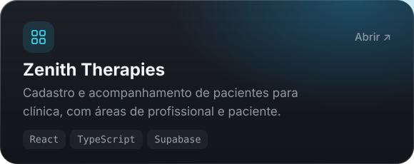
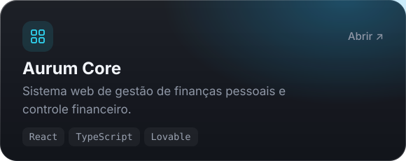
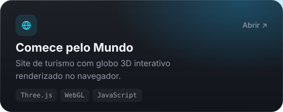
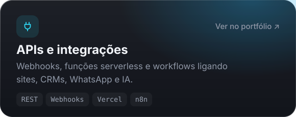

<a href="https://andersonlinares-dev-portfolio.lovable.app">
  
</a>

<p align="center">
  <a href="https://andersonlinares-dev-portfolio.lovable.app"></a>
  <a href="https://www.linkedin.com/in/andersonlinares/"></a>
  <a href="mailto:andersonlinares.dev@gmail.com"></a>
  <a href="https://wa.me/5561981296170?text=Ol%C3%A1%2C%20Anderson!%20Vim%20pelo%20seu%20GitHub%20e%20gostaria%20de%20conversar%20sobre%20um%20projeto."></a>
</p>

<br />


Sou formado em **Análise e Desenvolvimento de Sistemas** pela UDF e construo sistemas web de ponta a ponta: modelo os dados, escrevo as regras no back-end, crio as telas e conecto tudo a outras plataformas por API.

```txt
❯ agora      Analista de CRM / Gestor de Automações · Efeito Digital (Brasília, híbrido)
❯ front-end  React · TypeScript · Tailwind CSS · Vite · Three.js
❯ back-end   APIs REST · Webhooks · funções serverless · Supabase · autenticação e RLS
❯ dados      PostgreSQL · MySQL · SQL · PL/pgSQL · modelagem
❯ ia         OpenAI · Claude · Claude Code · n8n com MCP
❯ idiomas    Português (nativo) · Espanhol (nativo) · Inglês (intermediário)
```

<br />


<p>
  <a href="https://zeniththerapiessystem.lovable.app"></a>
  <a href="https://aurumcore.lovable.app"></a>
  <a href="https://comece-pelo-mundo.vercel.app"></a>
  <a href="https://andersonlinares-dev-portfolio.lovable.app/#projetos"></a>
</p>

<p align="center"><sub>Mais projetos, landing pages e uma simulação interativa da arquitetura em <a href="https://andersonlinares-dev-portfolio.lovable.app">andersonlinares-dev-portfolio.lovable.app</a></sub></p>

<br />


<p>
  
  <br />
  
</p>

<br />

<a href="https://wa.me/5561981296170?text=Ol%C3%A1%2C%20Anderson!%20Vim%20pelo%20seu%20GitHub%20e%20gostaria%20de%20conversar%20sobre%20um%20projeto.">
  
</a>

<details>
<summary><sub>English</sub></summary>
<br />

**Systems Developer** based in Brasília, Brazil, with a degree in Systems Analysis and Development (UDF). I build web systems end to end — data modeling, back-end rules, React/TypeScript interfaces and API integrations. Currently CRM Analyst / Automation Manager at Efeito Digital. Portfolio: [andersonlinares-dev-portfolio.lovable.app](https://andersonlinares-dev-portfolio.lovable.app)

</details>
